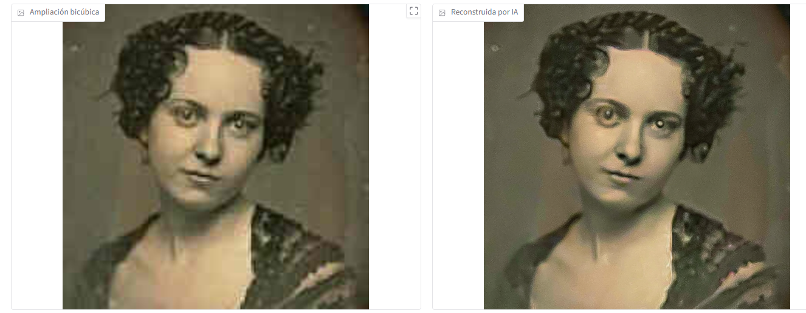
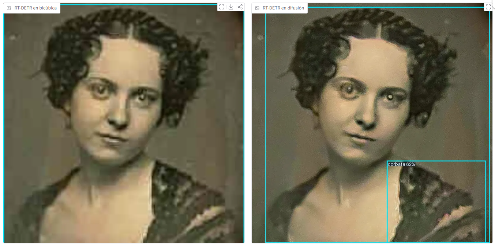

# Álbum x4

Una app que agranda fotos chicas 4 veces con un modelo de difusión y te muestra qué partes de la imagen inventó.

## Persona usuaria

**Marina** tiene 50 años y está pasando a la computadora el álbum de fotos de su familia. Escanea las copias viejas y las comparte por chat. Se maneja bien con el celular y la compu, pero no quiere ponerse a elegir parámetros técnicos.

**Su problema:** muchas fotos quedan chiquitas y pixeladas, y al agrandarlas se ven mal. Y le queda una duda que ninguna app le resuelve: quiere saber qué viene de la foto de su abuela y qué agregó el programa.

**Lo que necesita:** agrandar la foto, ponerla al lado de la original para compararlas, ver en qué zonas se metió el programa (ojos, pelo, ropa) y descargar una copia que diga claramente que fue reconstruida, para que nadie en la familia la confunda con la foto original.

## Ejecutar en Google Colab

1. Abrí [Google Colab](https://colab.research.google.com/) y subí [el notebook](colab/ejecutar_en_colab.ipynb) desde **Archivo → Subir notebook**. Colab también permite abrirlo desde GitHub una vez publicado.
2. Activá **Entorno de ejecución → Cambiar tipo de entorno de ejecución → GPU**. Una T4 es el punto de partida.
3. Ejecutá las celdas en orden. Para cargar la carpeta desde tu equipo, subí el ZIP del proyecto completo, con `app.py`, `uv.lock`, `src/` y `assets/`. Si tenés el paquete local `album-x4-colab.zip`, usá ese archivo. Una vez en GitHub, también podés indicar la URL del repositorio en la primera celda de código.
4. Esperá a que aparezca **Álbum x4** debajo de la última celda y usá la app en ese panel. Mantené la celda activa mientras la uses. Si falla el arranque, revisá los mensajes debajo del código. La primera ampliación descarga los pesos y tarda más.
5. En la demo usá fotos públicas como las incluidas. El panel integrado usa el enlace temporal de Gradio para conectarse a Colab. Quien tenga ese enlace puede acceder a la app mientras esté activa.

## Ejecutar en local

Desde la carpeta del proyecto, con [uv](https://docs.astral.sh/uv/getting-started/installation/) y una NVIDIA compatible con CUDA 13.0. El entorno fijado apunta a Linux x86-64 y Windows x64. Reservá espacio para PyTorch, CUDA y varios GB de pesos.

```bash
uv sync --locked
uv run --locked app.py --entorno
uv run --locked app.py
```

Abrí la dirección localhost que indica Gradio. Los modelos públicos se descargan en la primera ejecución. Las versiones de los paquetes quedan en [uv.lock](uv.lock).

## Uso

1. Subí un JPG o PNG o elegí una de las cinco [fotos de ejemplo](assets/FUENTES.md).
2. Empezá con **Más detalle** e intensidad **20**, la configuración usada en la primera ampliación x4 del notebook de prueba. También podés elegir **Suave** e intensidad **10** para repetir la configuración de la primera versión de la app. Para aislar el efecto del perfil, usá la misma intensidad y la misma foto en ambas corridas.
3. Presioná **Ampliar foto**. En **Lado a lado** se ven completas la bicúbica y la salida de IA, ambas en PNG. En **Deslizador** podés inspeccionar un mismo punto en la entrada y la reconstrucción. En **Original y mapa** podés volver a la foto recibida y ver las diferencias frente a bicúbica.
4. Leé el informe y desplegá **Ver cajas de detección** si querés ubicar un objeto. Descargá el PNG con el aviso de IA.

## Qué es real y qué es inventado

La foto de entrada es el registro disponible. Stable Diffusion se guía por sus formas y tonos y estima detalle fino, como grano, bordes de pupilas o textura de ropa. Incluso un resultado convincente puede alterar rasgos, letras o colores. Para comprobarlos hace falta otro escaneo, otra foto o el soporte físico. Conservá el original para archivo histórico, noticias o cualquier uso como evidencia.

El **mapa de diferencias** marca en tonos claros dónde más se separa la salida de la interpolación bicúbica. El porcentaje cuenta píxeles sobre un umbral de diferencia suavizada. Un tono claro puede corresponder tanto a un borde realzado como a un detalle inventado. La interfaz y el PNG indican **«Reconstruida por IA. Los detalles finos son estimaciones.»**

### Prueba en Colab con el retrato de 1858

La foto original de **200 × 200 px** se amplió a **800 × 800 px** con ambos ajustes. En **Más detalle**, los ojos y el pelo se ven más definidos que en la bicúbica. También se marcan más los reflejos de las pupilas y se alisa la piel. Para comprobar cómo eran esos detalles haría falta una fuente independiente. [Foto original de 1858](https://commons.wikimedia.org/wiki/File:Vintage_female_photograph_2.jpg)



| Ajuste probado | Píxeles sobre el umbral del mapa | Detecciones en la reconstrucción |
| --- | ---: | --- |
| Suave · intensidad 10 | 10,7 % | 1 persona |
| Más detalle · intensidad 20 | 20,1 % | 1 persona y 1 «corbata» |

Las dos corridas cambiaron el prompt y la intensidad. El porcentaje mide cuánto se aparta cada salida de la bicúbica con una diferencia suavizada superior a 8/255.

**Caso de error.** Con **Más detalle · 20**, RT-DETR marcó el hombro y el borde de la ropa como «corbata», con **62 % de puntuación**. Al inspeccionar esa zona, parece un falso positivo. La caja permite ubicar la discrepancia y revisarla a simple vista.



Para una verificación con referencia, el [ejemplo de Edward Curtis](assets/FUENTES.md) incluye la foto de mayor resolución de la que se obtuvo la entrada chica. En el prototipo, el prompt de foto antigua produjo más grano y otra clasificación errónea sobre la ropa. [Comparación del prototipo](assets/demo/detalle-prototipo.png) · [Detecciones del prototipo](assets/demo/rtdetr-prototipo.png)

## Arquitectura y modelos

```text
Gradio → JPG/PNG → orientación, RGB y límite de tamaño
                      ├→ interpolación bicúbica ──┐
                      └→ Stable Diffusion x4 ──────┴→ mapa + RT-DETR sobre las dos versiones
                                                   → comparador + informe + PNG marcado
```

| Componente | Configuración | Licencia |
| --- | --- | --- |
| Stable Diffusion x4 Upscaler | FP16 en GPU, 30 pasos y semilla 0. **Más detalle** usa `a sharp, high quality photograph` y **Suave** usa `a photograph`. Revisión `572c992`. | [CreativeML Open RAIL++-M](https://huggingface.co/stabilityai/stable-diffusion-x4-upscaler) |
| RT-DETR R50VD | Detección de objetos de COCO en CPU, umbral de puntuación 0,50 y recuento por categoría. Revisión `df939e6`. | [Apache 2.0](https://huggingface.co/PekingU/rtdetr_r50vd) |

**Stack.** Python 3.12 y uv, Gradio 6.31.0, PyTorch 2.14.1 con CUDA 13.0, Diffusers 0.42.1, Transformers 5.22.1, Pillow, NumPy y SciPy. Los modelos se cargan una vez por sesión y la app procesa una solicitud a la vez en GPU.

**Hardware registrado en el prototipo.** Google Colab en Linux, Tesla T4 de 15 GiB de VRAM según `nvidia-smi` y Python 3.13. Una foto de 200 × 200 px se amplió a 800 × 800 px en 21 segundos, con pico de 3,8 GB asignados por PyTorch durante esa prueba.

**Prueba real de la app.** Se ejecutaron los dos ajustes del retrato en Google Colab con la interfaz Gradio integrada en el notebook. Queda registrar el modelo de GPU, la VRAM y el tiempo de la corrida final.

**Verificación local de esta versión.** Arranque de la interfaz en Gradio y recorrido con las cinco fotos bajo Python 3.12, con difusión y detecciones simuladas. Se comprobaron el comparador, el mapa, la descarga con aviso, la transparencia en PNG y los mensajes ante una entrada ausente o inválida.

## Procesamiento digital aplicado

- **Muestreo y resolución espacial.** La difusión cuadruplica ancho y alto de la entrada de trabajo. La vista de vecino más cercano repite los píxeles para hacer visible la cuadrícula; la bicúbica estima valores entre muestras y sirve como línea base clásica. Para entradas con más de 256 px de lado, Lanczos reduce la imagen antes de la ampliación.
- **Filtrado espacial.** El mapa promedia la diferencia absoluta en RGB y aplica un filtro gaussiano con sigma de 4 px para resaltar regiones. La escala de color satura a partir de 30 unidades y el porcentaje usa un umbral de 8 sobre 255.
- **Espacio de color.** Pillow corrige la orientación EXIF y normaliza a RGB; en una foto PNG con transparencia, el fondo es blanco.

## Decisiones de diseño y límites

- **Transparencia y control.** Gradio muestra el progreso de cada etapa, las dimensiones efectivas y los ajustes usados. El perfil cambia la descripción que recibe el modelo y la intensidad cambia `noise_level` de 0 a 40. La difusión genera detalles incluso a 0.
- **Explicabilidad.** La comparación, el mapa y las cajas permiten revisar regiones concretas. El conteo por clase detecta cambios aunque el total de objetos siga igual. Un conteo estable aporta información sobre las clases detectadas y deja abierta la revisión de caras, texto y cambios de posición.
- **Límites de entrada.** JPG o PNG de hasta 12 MB y 4096 px por lado. La entrada de trabajo tiene hasta 256 px por lado para limitar la memoria. El alcance es la ampliación de copias chicas. En archivos con más resolución se informa la reducción previa.
- **Decisiones sobre las fotos.** La exportación muestra el aviso en una franja y en los metadatos del PNG. Usá imágenes públicas o con autorización en la demo. Para fotos familiares privadas, elegí la ejecución local cuando tengas una GPU compatible.

### Resultados exploratorios

En cinco pares con referencia del notebook de prueba, la bicúbica obtuvo PSNR medio de 28,39 dB y SSIM medio de 0,793. La difusión con prompt antiguo obtuvo 25,91 dB y 0,560. El PSNR mide similitud de píxeles y el SSIM, similitud estructural. La bicúbica conservó mejor la referencia en esa muestra, aunque visualmente la difusión incorporó más textura. Estas métricas son exploratorias y se calcularon sobre el prototipo.

## Uso de IA en el desarrollo

**Herramientas.** Codex y Claude, en conversación, para desarrollar el prototipo en un notebook paso a paso. Codex, para armar el repositorio final.

**Qué hizo la IA.** Claude escribió el código de cada etapa del prototipo. Codex reorganizó ese código en módulos, fijó las versiones de las librerías y armó la guía para ejecutar en Google Colab.

**Qué hizo la estudiante.** Eligió la subtarea A y acotó el alcance a un solo detector, una línea base clásica y un único control de intensidad. Ejecutó cada etapa en Colab, probó la app con distintas fotos y ajustes, detectó y reportó los errores que aparecieron (como una función incompleta o una carpeta faltante) y calibró el umbral del mapa de diferencias probando varios valores. Comparó los resultados visualmente y, a partir de esa comparación, se recuperó el ajuste de nitidez del prototipo como perfil inicial. Revisó el contenido de este proyecto.

**Verificación.** Las pruebas con fotos reales en Colab, la lectura de los resultados y la revisión del código final fueron realizadas por la estudiante.

**Autor:** Pablo Silvarredonda · IFTS 24 · Procesamiento Digital de Imágenes e Introducción a Visión por Computadora · 2026.
